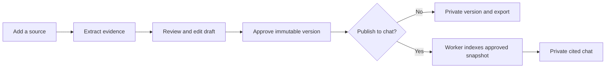
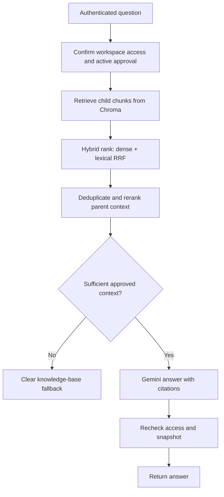
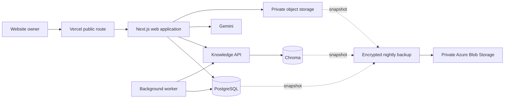

# SiteSage

> Turn website content, repositories and documents into reviewed, evidence-backed answers.

[Open SiteSage](https://portfolioai-mu.vercel.app) · [Cloud operations](docs/CLOUD_HOSTING.md) · [RAG integration](docs/WEBSITE_RAG_INTEGRATION.md)

SiteSage is an authenticated knowledge workspace for any website. It captures source material, lets the owner review every extracted fact, and makes only approved versions available to a private, cited AI chat.

## What it does

- Imports website pages, GitHub documentation and uploaded documents.
- Extracts evidence with provenance, supports review/editing, and creates immutable approved versions.
- Builds a private Chroma vector index only from approved content.
- Answers with calibrated parent-child retrieval, hybrid ranking and cross-encoder reranking.
- Shows source citations and clearly distinguishes unavailable knowledge from a model/service error.
- Gives each user their own workspace, sources, versions, audit trail and chat access.
- Supports Google sign-in and optional passkeys.
- Exports approved knowledge as JSON or Markdown, with restores returning to a reviewable draft.
- Removes source content from the application and queues the matching vector purge when a source or account is erased.

## Owner workflow



Drafts, raw imports and un-published approvals are not chat knowledge. Publishing is an explicit owner decision.

## How answers are created



The retrieval policy uses 48-token child chunks with a 12-token overlap, parent-context reranking, a 256-token embedding admission limit, calibrated hybrid fusion, and a pinned cross-encoder. Query expansion and semantic pre-filtering remain disabled because calibration did not show an improvement.

## Architecture



The public URL is routed through Vercel to an Azure-hosted application stack. Docker Compose runs the web app, background worker, PostgreSQL, Chroma, knowledge service and HTTPS proxy. Only HTTP/HTTPS are publicly reachable; the database, vector database and knowledge API remain on private container networking.

## Security and data controls

- API keys and RAG credentials stay server-side; no browser receives a database, Chroma or Gemini key.
- PostgreSQL uses separate runtime, identity, worker and administrator roles.
- Each request is scoped to the authenticated workspace; chat also rechecks membership and the exact approved snapshot after generation.
- Publishing, source removal and account removal are durable background jobs with leases, retries and receipt tracking.
- The knowledge bridge permits the website only to index, query, inspect status and purge the approved-profile dataset.
- Backup archives use AES-256-CBC with PBKDF2 and are uploaded using an Azure managed identity to a private Blob container.
- Logs are capped per service, containers restart automatically, and temporary SSH access is restricted to the operator's IP then removed.

## Deployment and verification

The deployed service has been checked end-to-end with real upload, extraction, approval, vector indexing, cited answers, missing-information fallback, tenant isolation, source invalidation and account erasure. Google sign-in was manually confirmed on the live dashboard.

Current automated checks include:

| Area | Evidence |
| --- | --- |
| Website | 101 passing tests, TypeScript check and Next.js build |
| RAG integration | 73 RAG tests; 11 cloud integration checks using persistent Chroma and Gemini |
| Knowledge service | 46 checks, with two SDK-specific checks skipped in that run |
| Supply-chain check | `npm audit` reported zero known vulnerabilities after Next.js 16.4.6 |
| Backup | Encrypted upload/read-back checksum and isolated PostgreSQL restore |

Operational health is exposed at `/api/health`. Backups run nightly at 03:00 IST and retain seven days of encrypted snapshots. See [Cloud hosting](docs/CLOUD_HOSTING.md) for recovery steps, cost context and known limits.

This is a small single-VM deployment. It does not claim high availability, sustained load testing, a complete VM-loss recovery drill, or guaranteed third-party model uptime.

## Run locally

Requirements: Node.js, PostgreSQL, Python and Docker. Copy the documented server settings from [`.env.example`](.env.example) into ignored local configuration; never commit credentials.

```powershell
npm ci
npm run db:setup
npm run dev
```

In a second terminal, run the background worker:

```powershell
npm run worker
```

For the full local RAG stack, follow [Website, RAG and Chroma integration](docs/WEBSITE_RAG_INTEGRATION.md). It documents the required knowledge service, local embedding/reranking models and server-only Gemini configuration.

## Useful commands

```powershell
npm run check
npm test
npm run build
node scripts/verify-rag-integration.ts
```

The RAG verification script uses disposable identities and removes its own test data. Run it only against a controlled environment with the ordinary worker stopped, as described in the integration guide.

## Project scope

SiteSage currently provides private, authenticated workspace chat. A public embeddable visitor widget and public chat endpoint are planned separately and are not part of the deployed product.

## Documentation

- [Cloud hosting and operations](docs/CLOUD_HOSTING.md)
- [Website, RAG and Chroma integration](docs/WEBSITE_RAG_INTEGRATION.md)
- [RAG configuration and calibration](docs/RAG_FINAL_CONFIGURATION.md)
- [Implementation history and checks](plan.md)
- [Security and verification evidence](docs/CLOUD_HOSTING_VERIFICATION.json)
